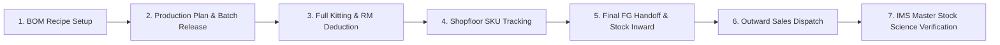

# Bharat Impex ERP & MES — End-to-End System Testing Guide

This guide walks you through a complete, realistic lifecycle test of the entire manufacturing execution and inventory system:


---

## 📋 Test Scenario Specifications

We will use a dedicated test run with **100 PCS** of **`CON-1403` (ANGLE COCK ABS CONTY)**:

| Item | Code / Details | Test Parameters |
| :--- | :--- | :--- |
| **Finished Good (FG)** | `CON-1403` | *ANGLE COCK ABS CONTY* |
| **Batch Number** | `BATCH-TEST-001` | Planned Lot: **100 PCS** |
| **Raw Material 1 (Body)** | `RM-000001` | *Brass Rod 25MM* (0.350 KG/unit = **35.0 KG**) |
| **Raw Material 2 (Box)** | `RM-000008` | *Duplex Printed Box A1* (1.000 PC/unit = **100 PCS**) |
| **Source Store** | WH-MAIN (ID: 1) | Main Raw Material & RM Store |
| **FG Warehouse** | WH-FG (ID: 3) | Ready Finished Goods Warehouse |

---

## Step 1: Verify / Configure BOM Recipe

1. Navigate to: **[SKU & Multi-BOM Recipe Sheet](http://localhost/bharat%20impex%20stock%20project/#/sku-bom)**
2. In the table, find or add the recipe for **`CON-1403`**:
   * **Constituent 1**: Material `RM-000001` (*Brass Rod 25MM*), Qty: `0.350`, Unit: `KG`
   * **Constituent 2**: Material `RM-000008` (*Duplex Printed Product Box A1*), Qty: `1.000`, Unit: `PCS`
3. Click the top button: **Save All BOM Recipes**.
4. **Expected Result**: A green toast notification confirms: *"Successfully saved BOM recipe constituents to database!"*

> [!NOTE]
> This recipe establishes the formula that Full Kitting will calculate automatically.

---

## Step 2: Ensure RM Store Has Initial Stock

Before kitting, ensure your RM Store has sufficient stock for the test (or you can use the Shopfloor Override):
1. Navigate to: **[Inward & Outward Register](http://localhost/bharat%20impex%20stock%20project/#/in-out-register)**
2. Click **New Inward Entry (Purchase / Return)**:
   * **Type**: `RM`
   * **Item**: `RM-000001` (*Brass Rod 25MM*)
   * **Warehouse**: `WH-MAIN`
   * **Quantity**: `100` KG (Rate: ₹580/KG)
   * **Party**: Standard Vendor
3. Repeat or add line for `RM-000008` with **200 PCS**.
4. Submit the inward entry.
5. **Expected Result**: Inward register records the purchase; `stock` table balance updates.

---

## Step 3: Create Production Plan & Release Batch

1. Navigate to: **[Production Planning](http://localhost/bharat%20impex%20stock%20project/#/planning)**
2. Click **Create Production Plan**:
   * **Product**: Select `CON-1403` (*ANGLE COCK ABS CONTY*)
   * **Target Quantity**: `100` PCS
   * **Target Warehouse**: `WH-FG`
   * **Priority**: `HIGH`
3. Click **Save Plan**.
4. On the plan card/row, click **Release Batch**:
   * **Batch / Release No**: `BATCH-TEST-001`
   * **Quantity**: `100` PCS
5. **Expected Result**: The batch is created with status **ACTIVE** and `rm_deducted: 0`.

---

## Step 4: Full Kitting (Upfront RM Deduction)

1. Stay on **[Production Planning](http://localhost/bharat%20impex%20stock%20project/#/planning)** or open **[SKU Tracking Sheet](http://localhost/bharat%20impex%20stock%20project/#/sku-tracking)**.
2. Click the **Full Kitting** button on batch `#BATCH-TEST-001`.
3. The **Full Kitting Modal** opens:
   * Inspect the auto-calculated requirement:
     * `RM-000001`: `100 units * 0.350 = 35.0 KG`
     * `RM-000008`: `100 units * 1.000 = 100 PCS`
   * Notice that the values match the BOM.
4. Click **Confirm & Deduct RM Stock Now**.
5. **Verification**:
   * Status updates to **Kitted / RM Deducted** with a green badge.
   * In database `stock_ledger`, rows are inserted with `transaction_type = 'PRODUCTION_CONSUMPTION'` and reference `BATCH-TEST-001`.
   * RM Store inventory decreases by 35 KG and 100 PCS.

---

## Step 5: Shopfloor Execution (SKU Tracking Sheet)

1. Navigate to: **[SKU Tracking Sheet](http://localhost/bharat%20impex%20stock%20project/#/sku-tracking)**.
2. Locate batch `#BATCH-TEST-001`.
3. Progress the batch through the stages:
   * **Casting**: Enter Received `100`, Good `98`, Scrap `2`.
   * **Machining**: Received `98`, Good `97`, Scrap `1`.
   * **Grinding**: Received `97`, Good `96`, Scrap `1`.
   * **Polishing**: Received `96`, Good `95`, Scrap `1`.
   * **Assembly**: Received `95`, Good `95`.
   * **Packing / Ready FG**: Final Good Qty: `95 PCS`.
4. Click **Save Stage Progress**.
5. **Expected Result**: Real-time stage WIP and yield percentages update across the tracking pipeline.

---

## Step 6: Final Handoff to Ready FG Stock

1. On the **Ready FG** stage column for `#BATCH-TEST-001`, click **Deposit into Ready FG Stock** (or **Complete Batch**).
2. Confirm the deposit dialog:
   * **Good Quantity to Stock**: `95 PCS`
   * **Target Warehouse**: `WH-FG (Ready Finished Goods)`
3. Click **Confirm Deposit**.
4. **Verification**:
   * Batch status changes to **COMPLETED**.
   * In `stock_ledger`, a new entry is generated:
     * `material_type`: `FG`
     * `material_code`: `CON-1403`
     * `quantity_in`: `95.000`
     * `transaction_type`: `PRODUCTION_OUTPUT`
     * `transaction_date`: Today's Date
     * `reference_number`: `BATCH-TEST-001`
   * Finished Goods inventory for `CON-1403` increases by **+95 PCS**.

---

## Step 7: Record Outward Sales Dispatch

1. Navigate to: **[Inward & Outward Register](http://localhost/bharat%20impex%20stock%20project/#/in-out-register)**.
2. Click **New Outward Entry (Sales Dispatch)**:
   * **Type**: `FG`
   * **Item**: `CON-1403` (*ANGLE COCK ABS CONTY*)
   * **Warehouse**: `WH-FG`
   * **Customer / Party**: Select any customer (e.g. *Gupta Sanitary Store*)
   * **Quantity**: `20` PCS
   * **Invoice / DC No**: `INV-TEST-001`
3. Click **Submit Outward Entry**.
4. **Verification**:
   * Stock ledger logs `transaction_type: SALE`, `quantity_out: 20`.
   * Live stock drops by 20 PCS.

---

## Step 8: Verify Live Stock Science & IMS Master

1. Navigate to: **[IMS Tri Nagar Master](http://localhost/bharat%20impex%20stock%20project/#/ims-master)**.
2. Select Category / Filter for `ABS ACCESSORIES` or search `CON-1403`.
3. Locate the column for **TODAY LIVE**:
   * Hover over the highlighted cell with the pulsating indicator.
4. **Examine the Tooltip**:
   ```text
   19 Oct (TODAY LIVE): <Live Balance> PCS
   • Zone: Green / Purple Stock
   • Opening: <Yesterday's Closing>
   • Total Inward: +95
   • Total Outward: -20
   ```
5. **Verify Accounting Balance**:
   $$\text{Live Stock} = \text{Opening Stock} + \text{Total Inward (95)} - \text{Total Outward (20)}$$

---

## 🔍 Automated Verification Script

You can also run this command in your PowerShell terminal to immediately test the database state and API response:

```powershell
& 'C:\xampp\php\php.exe' tests/test_api.php
```

All 7 core ERP engine tests will execute and report passing status.
